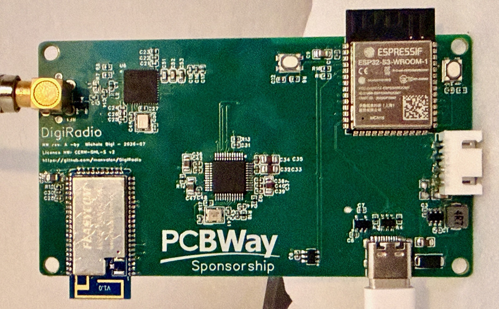

<div align="center">

# DigiRadio

### DAB+/FM Bluetooth Receiver with SigmaDSP Audio Processing

**Open-source digital radio — Si4684 tuner · ADAU1701 SigmaDSP · Bluetooth aptX Adaptive · ESP32-S3**


[](Software/LICENSE)



</div>

---

## Overview

**DigiRadio** is an open-source digital radio receiver that combines terrestrial
broadcast reception (**DAB+ / DAB / FM**) with a programmable audio-processing
stage and high-quality **Bluetooth** audio output.

Incoming broadcast audio is decoded by a Silicon Labs **Si4684** digital-radio
receiver, processed by an Analog Devices **ADAU1701 SigmaDSP** (equalisation,
mixing, level control), and transmitted over Bluetooth by a Qualcomm QCC3056-based
**Feasycom FSC-BT1035** module supporting the **aptX Adaptive** codec. An Espressif
**ESP32-S3** acts as the host controller, orchestrating the three subsystems and
providing Wi-Fi connectivity, encrypted credential storage, and a browser-based
configuration UI.

The entire tuner → DSP → Bluetooth path is **fully digital (I²S, 48 kHz / 24-bit)** —
no analogue conversions are introduced between the tuner and the wireless link.

```
 FM/DAB antenna → [ Si4684 ] --I²S--> [ ADAU1701 DSP ] --I²S--> [ FSC-BT1035 ] → aptX
                       ↑                     ↑                        ↑
                       └──── SPI ──── [ ESP32-S3 host ] ──── UART ────┘
                                             │  I²C
                                      Wi-Fi · NVS · HTTP UI
```

---

## Key Features

### Hardware

> **v2 board:** the second board, with an ADAU1452 DSP, is in [`Hardware-v2/`](Hardware-v2/) (KiCad project and its own [firmware](Hardware-v2/firmware/)). Everything below describes the first board.

- **DAB+ / DAB / FM** reception (Si4684) via external whip antenna (SMA)
- **Fully digital audio path** — no avoidable A/D–D/A conversions
- **Programmable audio processing** on the ADAU1701 SigmaDSP
- **Bluetooth 5.2** output with **aptX / aptX HD / aptX Adaptive**
- **ESP32-S3** host with native USB, Wi-Fi and BLE
- **USB-C powered**; single-rail 3.3 V + low-noise 1.8 V for the tuner
- **6-layer impedance-controlled PCB**, 50 × 90 mm, two ground planes
- Three antennas (ESP32 2.4 GHz, BT1035 2.4 GHz, FM/DAB SMA) with proper keep-outs

### Firmware (ESP-IDF, C++23 — fw **0.13.0**)

| Area | Capability |
|------|------------|
| **Boot & chips** | Si4684 DAB+FM firmware load (HOST_LOAD blobs), ADAU1701 RAM program at every boot, BT1035 I2S slave init (`AT+AUXCFG=3`, `AT+I2SCFG=67`) |
| **Tuner** | FM tune/seek, DAB ensemble tune, service scan & play, RSQ/RDS, DAB event status |
| **Now playing** | FM RDS (PS, RadioText, PI, PTY) and DAB Dynamic Label (DLS) in status JSON and web UI |
| **Audio** | 6-band EQ, input mixer, stereo/bass enhancement overlays, profile persist in encrypted NVS |
| **Presets** | Station list CRUD, reorder, recall with audio profile re-apply, last-preset restore at boot |
| **Bluetooth** | Discoverable pairing, A2DP status, disconnect |
| **Network** | SoftAP setup mode, STA provisioning, tabbed gzipped SPA (`/`), typed JSON REST API |
| **Security** | NVS + flash encryption at rest (dev mode); keys never in repo |
| **Quality** | **13** host unit tests, 4 CI jobs (tests, Doxygen, manual sync, blob policy) |

Architecture follows a **functional core + imperative shell**: pure domain logic
(compilation, JSON, EQ design, RDS/DLS parsing) runs on the host under `ctest`;
drivers and FreeRTOS live in thin ESP-IDF components. See [`Software/AGENTS.md`](Software/AGENTS.md).

---

## Firmware Progress

Releases on `main` (newest first; builds are published as [GitHub releases](https://github.com/manvalan/DigiRadio/releases)):

| Version | Highlights |
|---------|------------|
| **0.13.0** | SigmaDSP program v2, audio presets stored in the radio, click-free input changes, alarm crash fix |
| **0.12.x** | DAB DL+ and FM RT+ title/artist, complete FM RadioText, web radio heap headroom, hung OTA images roll back |
| **0.11.x** | Alarm table and sleep timer; Si4684 image store; first release builds from GitHub Actions |
| **0.10.x** | Working web radio, phone audio over TCP, OTA probation |
| **0.9.x** | RDS alternate frequencies and DAB service following, `/api/tuner/signal`, Bluetooth on/off, Wi-Fi reset |
| **0.8.5** | BT1035 I2S slave boot init (schematic-aligned); I2C pull-ups R1/R16 confirmed 2 kΩ; `Hardware/DATASHEET/` bundle |
| **0.8.4** | Dual OTA + DSP blob updates, EEPROM identity, System tab OTA/DSP upload |
| **0.8.3** | NVS + flash encryption (development mode), `initEncryptedStorage`, security docs |
| **0.8.2** | Tabbed Web UI (now-playing, 6-band EQ, all REST); Si4684 blob CI policy |
| **0.8.1** | `IntegrationService` — boot preset recall, tune orchestration (tuner + audio + NVS `last_preset`); services stub removed |
| **0.8.0** | Preset reorder API/UI; broadcast metadata (RDS + DAB DLS); `readDabServiceData` driver path |
| **0.7.1** | CI workflow (host tests, Doxygen, manual sync); Doxygen warnings cleared |
| **0.7.0** | Station presets (NVS `station_list`), BT1035 pairing, full `/api/stations/*` |
| **0.5–0.6** | ADAU1701 runtime EQ/mixer, Si4684 tuning & DAB service list, BT1035 driver |
| **0.3–0.4** | Secure store, Wi-Fi provisioning, companion-chip boot, walking skeleton |

**Next:** firmware for the [v2 board](Hardware-v2/); see ([`Software/docs/security-flash-nvs.md`](Software/docs/security-flash-nvs.md),
[`Software/docs/TODO.md`](Software/docs/TODO.md)). Contributing:
[`CONTRIBUTING.md`](CONTRIBUTING.md).

---

## Repository Structure

```
DigiRadio/
├── .github/workflows/        CI — host tests, Doxygen, manual sync, Si4684 blob policy
├── Hardware/
│   ├── schematics/           Schematic (PDF)
│   ├── gerber/               Gerber + drill (fabrication)
│   ├── bom/                  Bill of Materials
│   ├── pick-and-place/       CPL / centroid
│   ├── easyeda/              EasyEDA source
│   └── 3d/                   Renders / STEP
├── Hardware-v2/              Second board (ADAU1452) — see its README
│   ├── kicad/                KiCad project
│   └── firmware/             v2 firmware
├── Software/                 Firmware project root — open this in Cursor
│   ├── AGENTS.md             Authoritative coding rules for agents
│   ├── instructions.md       Agent kickoff & slice roadmap
│   ├── Doxyfile              API documentation gate
│   ├── components/
│   │   ├── core/             Pure domain (host-tested, no ESP-IDF)
│   │   ├── drivers/          Si4684, ADAU1701, BT1035
│   │   ├── services/         Tuner, audio, Bluetooth, station, integration
│   │   ├── secure_store/     NVS wrappers (Wi-Fi, profiles, presets)
│   │   └── net/              Wi-Fi, HTTP server, gzipped web UI
│   ├── docs/
│   │   ├── manual/           LaTeX technical manual (canonical)
│   │   ├── security-flash-nvs.md  NVS/flash encryption + HIL checklist
│   │   └── TODO.md           Agent backlog and completed tasks
│   ├── Firmware/             Si4684 blobs + ADAU1701 SigmaStudio export
│   ├── main/                 app_main, hardware bootstrap
│   └── tools/                fetch_si4684_firmware, check_*, gzip-www
├── CONTRIBUTING.md           human-facing dev guide
├── LICENSE                   CERN-OHL-S v2 (hardware)
└── README.md                 ← you are here
```

Build the manual from `Software/docs/manual/`:

```bash
cd Software/docs/manual && latexmk -lualatex manual.tex
```

---

## Getting Started

### Firmware (developers)

Open **`Software/`** as the Cursor project so `AGENTS.md` and `.cursor/rules/` load.

```bash
cd Software
idf.py set-target esp32s3
idf.py build
idf.py erase-flash flash   # once when first enabling encryption (0.8.3+)
idf.py -p <port> monitor
```

Host unit tests (no hardware):

```bash
cd Software
cmake -S components/core/test -B build-host \
      -DCMAKE_CXX_COMPILER="$(brew --prefix llvm)/bin/clang++"   # macOS
cmake --build build-host
ctest --test-dir build-host --output-on-failure
```

Quality gates (also enforced in CI):

```bash
cd Software
doxygen Doxyfile
python3 tools/check-manual-sync.py
python3 tools/check_si4684_blobs.py
```

Full build notes: [`Software/README.md`](Software/README.md) · security:
[`Software/docs/security-flash-nvs.md`](Software/docs/security-flash-nvs.md).

### First boot (device)

1. Power the board; ESP32 starts **SoftAP** setup mode (`DigiRadio-setup` — see manual).
2. Connect and open the gzipped web UI or call `GET /api/health`.
3. `POST /api/wifi` with STA credentials; device reboots into normal mode.
4. Tune via `/api/tuner/*`, manage presets via `/api/stations/*`, pair BT via `/api/bluetooth/*`.

Schemas, error tokens, and boot flow: [`Software/docs/manual/ch-api.tex`](Software/docs/manual/ch-api.tex).

---

## iOS App (igiRadio)

The companion iOS app **igiRadio** (tuning, presets, web radio, firmware
updates over Wi-Fi) is not part of this repository. It is currently
available as a beta on **TestFlight**: if you would like to try it,
contact the author (for example by opening an
[issue](https://github.com/manvalan/DigiRadio/issues)) to receive an invite.

---

## HTTP API (summary)

| Method | Path | Purpose |
|--------|------|---------|
| GET | `/api/health` | Status, firmware version, companion-chip flags |
| POST | `/api/wifi` | Provision STA credentials |
| GET | `/api/tuner/status` | Tuner snapshot incl. RDS/DLS metadata |
| GET | `/api/tuner/services` | DAB service list |
| POST | `/api/tuner/tune` · `/play` · `/seek` | Tuner control |
| GET/PUT | `/api/audio/profile` | ADAU1701 mixer + EQ |
| POST | `/api/audio/reset` · `/stereo-enhance` · `/bass-enhance` | Audio overlays |
| GET | `/api/bluetooth/status` | BT1035 state |
| POST | `/api/bluetooth/pair` · `/pair/stop` · `/disconnect` | Bluetooth control |
| GET/POST | `/api/stations` · `/remove` · `/reorder` · `/tune` | Preset list & recall |

Generated C++ API reference: run `doxygen Doxyfile` → `Software/docs/api/html/index.html`.

---

## Design Highlights

| Topic | Choice | Rationale |
|---|---|---|
| **Audio quality** | QCC3056 / aptX Adaptive | Codec dominates wireless quality; DAC lives in the sink |
| **Audio path** | Fully digital I²S | Avoids unnecessary A/D–D/A between tuner and Bluetooth |
| **I²S master** | ADAU1701 (12.288 MHz) | Clean ×256 → 48 kHz; avoids sample-rate mismatch |
| **Firmware style** | C++23, `std::expected`, RAII | Typed errors, host-testable core, no primitive obsession |
| **Stack-up** | 6-layer, 2× GND | Solid ground under RF, crystals and USB |
| **USB routing** | TOP, ref. GND | 90 Ω diff at manufacturable geometry |
| **Antennas** | 3 zones, diagonal 2.4 GHz | Coexistence separation + full-layer keep-outs |

---

## Status

| Layer | State |
|-------|--------|
| **Schematic** | Complete and reviewed |
| **PCB layout** | 6-layer, DRC clean, plane continuity verified |
| **BOM** | Finalised (manufacturable / sourced) |
| **Prototype** | Fabricated and assembled by PCBWay, working |
| **Firmware** | **0.13.0** on `main` — DAB+/FM, web radio, phone audio, alarms, OTA from the app |
| **Web UI** | Tabbed SPA covering every REST endpoint |
| **HIL** | Running on the assembled prototype |
| **Agent backlog** | Feature-complete on `main` (fw 0.13.0); see [`Software/docs/TODO.md`](Software/docs/TODO.md) |

---

## Manufacturing: fabrication and assembly by PCBWay

The DigiRadio board was fabricated and assembled by [PCBWay](https://www.pcbway.com/), who sponsored part of the cost ($100).

It's not an easy board to build by hand: 6 layers with impedance control, a QFN tuner (Si4684), an LQFP DSP, two 2.4 GHz modules and a USB-C connector. PCBWay handled fabrication and turnkey assembly, and the lead times were the normal technical ones for this kind of job. The only part they don't stock is the Feasycom FSC-BT1035, which I soldered by hand.

The part I want to highlight is the support. During bring-up I couldn't get the Si4684 tuner to work, and with a board like this it's hard to tell whether the problem is in the hardware or in the firmware. PCBWay's support team helped me check the board and the assembly, and that was essential: it let me rule out hardware problems and find the real cause. Without their help I would have spent much longer chasing the wrong issue.

The board is shared as a [project on PCBWay](https://www.pcbway.com/project/shareproject/DigiRadio_Open_Source_Hi_Fi_DAB_FM_Receiver_with_DSP_and_aptX_Adaptive_Blueto_a1952812.html), so you can order it directly. Disclosure: PCBWay gives me a small percentage of those orders as store credit.

**Technical notes.** The FSC-BT1035 footprint uses a BT806-compatible, pin-identical land pattern. Component
datasheets for design review live in
[`Hardware/DATASHEET/`](Hardware/DATASHEET/) (Si4684-A10, AN851, ADAU1701, FSC-BT1035).
See the [Technical Manual](Software/docs/manual/manual.tex) hardware chapter
and manufacturing notes for fabrication settings and MSL-3 handling of the BT
module.

---

## License

- **Hardware** (schematics, PCB, Gerbers, BOM): CERN-OHL-S v2 — see [`LICENSE`](LICENSE)
- **Firmware / Software**: Apache-2.0 — see [`Software/LICENSE`](Software/LICENSE)
- **Documentation**: CC BY 4.0

Intellectual property of the design remains with the author. You are free to study,
modify and build the hardware under the terms of the respective licenses.

---

## Author

**Michele Bigi** — Open-source hardware project.

*Contributions, issues and questions are welcome via the [issue tracker](https://github.com/manvalan/DigiRadio/issues).*
